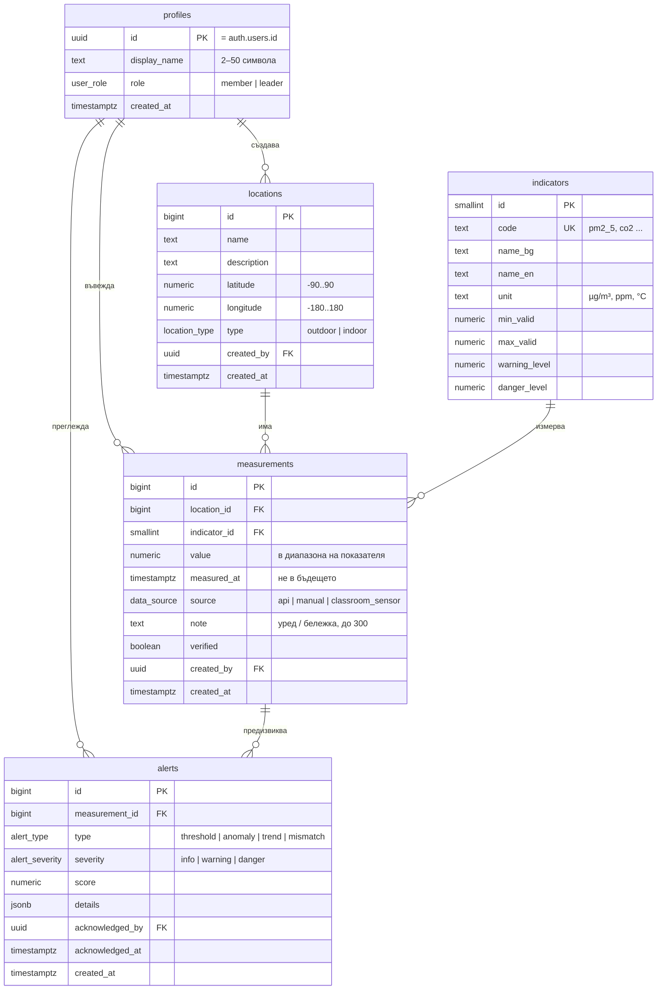

# ER диаграма — EcoMonitor

GitHub показва диаграмата автоматично (Mermaid).

## Връзки
| Връзка | Тип | При изтриване |
|---|---|---|
| locations → measurements | 1 : много | изтриват се и измерванията (CASCADE) |
| indicators → measurements | 1 : много | забранено, ако има измервания (RESTRICT) |
| measurements → alerts | 1 : много | изтриват се и сигналите (CASCADE) |
| profiles → locations / measurements / alerts | 1 : много | полето става NULL (данните остават) |

## Права (RLS) накратко
| Таблица | Гост | Член | Ръководител |
|---|---|---|---|
| indicators | чете | чете | всичко |
| locations | чете | добавя; редактира/трие свои | всичко |
| measurements | чете | добавя ръчни; редактира/трие свои | всичко + потвърждава + импорт от API |
| alerts | чете | създава | маркира като прегледан, трие |
| profiles | — | чете; редактира само своето име | същото (ролята не се сменя от клиента) |
